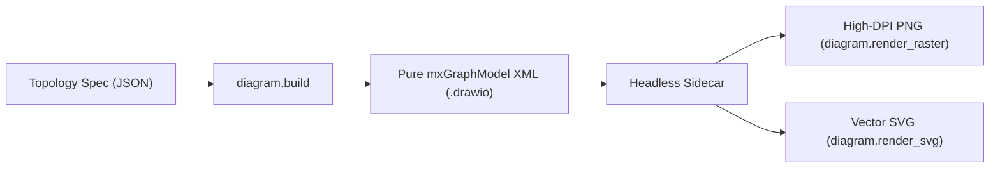

The Docwright Technical Diagrams Engine produces clean, native **Draw.io (`mxGraphModel`)** XML files and renders them headlessly to high-DPI PNG and SVG formats.

---

## 21 Core Invariants (MX_INV_01–21)

### 1. Pure Native Hierarchy (`MX_INV_01`)
Strictly forbids `<UserObject mermaidData/plantUmlData>`. All nodes and edges must be native `<mxCell>` XML children under `parent="1"`. This allows diagrams to be natively editable in any Draw.io editor without parsing plugins.

### 2. Orthogonal Perimeter Routing (`MX_INV_04`)
Edges use `edgeStyle=orthogonalEdgeStyle;` with standard perimeter anchor ports (`exitX, exitY, entryX, entryY` at `0.0`, `0.5`, `1.0`), preventing diagonal edge collisions through node centers.

### 3. Dynamic Geometry Scaling (`MX_INV_05`)
Entity table height scales dynamically based on field count:
```text
H = 43 * (N_fields + 1)
```
Traffic clearance corridors between parallel layout tracks maintain a minimum clearance of at least 60px.

### 4. Monochrome Academic Line-Art (`MX_INV_07`)
Diagrams default to high-contrast, clean academic line-art styling (`#ffffff` fill, `#000000` stroke) for maximum readability in whitepapers and technical reports.

---

## Rendering Pipeline




*Figure 1: Microservice architecture diagram generated via pure native mxGraphModel with orthogonal routing.*
