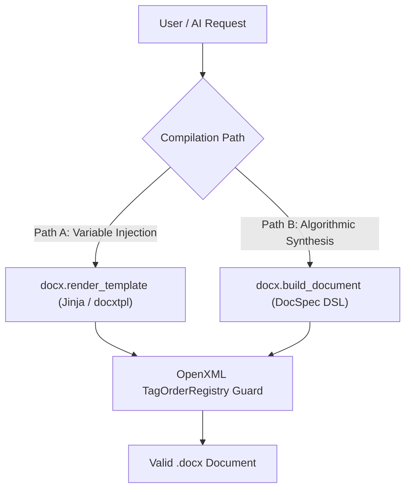

The Docwright Word (DOCX) Engine compiles declarative JSON specifications into Microsoft Word documents with strict OpenXML ECMA-376 schema guarantees.

---

## Core Invariants Enforced

### 1. The Last Paragraph Rule (`ERR_DOCX_001`)
Every table cell (`<w:tc>`) MUST terminate with at least one paragraph (`<w:p>`). The engine automatically injects `<w:p/>` in empty cells to prevent Word repair dialogs.

### 2. Run Text Overwrite Protection (`ERR_DOCX_002`)
Never overwrite `cell.text = "..."` directly, which destroys font styles, bolding, colors, and margins inherited from corporate templates. Mutations route through the **Surgical Run Splicer**.

### 3. Multi-page Table Integrity (`ERR_DOCX_003`)
Multi-page tables automatically receive:
- `<w:cantSplit/>` on all table rows to prevent rows from breaking mid-sentence across page splits.
- `<w:tblHeader/>` on header rows to repeat column titles at the top of every new page.

### 4. Dynamic Page Bounds (`ERR_DOCX_005`)
Image widths and table columns are dynamically scaled based on printable margins read directly from `<w:pgSz>` and `<w:pgMar>`, rather than assuming fixed paper dimensions.

---

## Dual Compilation Architecture

- **Path A (Template Rendering)**: Injects dynamic JSON data into pre-designed Word templates with Jinja tags (`{{ company_name }}`).
- **Path B (DocSpec DSL)**: Generates complete documents from scratch using typed paragraph blocks, headings, callout boxes, and 2D table grids.
