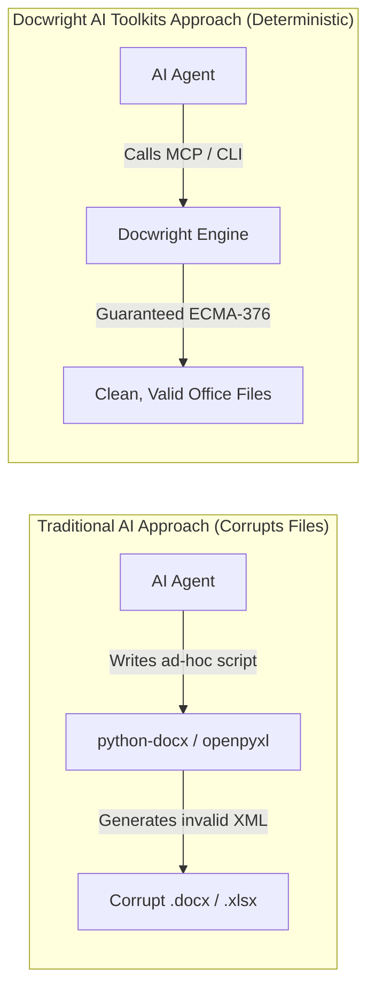

import { Tabs, TabItem } from '@astrojs/starlight/components';

**Docwright AI Toolkits** (`docwright-ai-toolkit`) is the AI-Native Office & Diagram Toolkit Plugin engineered specifically for modern AI Agents and developers.

It bridges the gap between Large Language Models (LLMs) and complex, binary enterprise office formats:
- **Microsoft Word (`.docx`)**
- **Microsoft Excel (`.xlsx`, `.xls`)**
- **Technical Diagrams (`.drawio`, `mxGraphModel`)**

---

## Why Standard AI Automation Breaks Office Documents

When modern LLMs (Claude, GPT-4, Gemini) generate or edit documents using direct library scripts (such as `python-docx` or `openpyxl`), they frequently create corrupt, unreadable, or cosmetically broken files:

1. **Word Schema Violations (`ERR_DOCX_001`)**: Omitting a paragraph `<w:p>` in an empty table cell violates ECMA-376 schema constraints, causing Word to display its dreaded repair dialog: *"Word found unreadable content"*.
2. **Table Splitting Across Pages (`ERR_DOCX_003`)**: AI scripts generate tables without `<w:cantSplit/>` and header repeat flags `<w:tblHeader/>`, causing table rows to split awkwardly across page breaks.
3. **Formula & Calculation Breakage (`ERR_XLSX_003`)**: Directly overwriting cells destroys cell dependency graphs, overwrites live calculation formulas (`=SUM`, `=COUNTIF`), and strips embedded DrawingML shapes.
4. **DrawingML Logo Stripping (`ERR_XLSX_006`)**: Resaving template sheets with basic openpyxl scripts strips corporate cover logos and embedded drawing vectors.

Docwright solves these problems by providing a **deterministic compilation layer** enforcing 100% ECMA-376 OpenXML compliance, dynamic geometry calculation, and AST formula shifting.

---

## Quick Comparison

---

## Next Steps

- [Why Standard AI Fails at Office Docs](/getting-started/why-ai-fails/)
- [Installation Guide](/getting-started/installation/)
- [1-Click AI IDE Integration (Cursor, Claude, Antigravity)](/getting-started/ai-ide-setup/)
- [Explore the 51 Tools Reference](/reference/)
